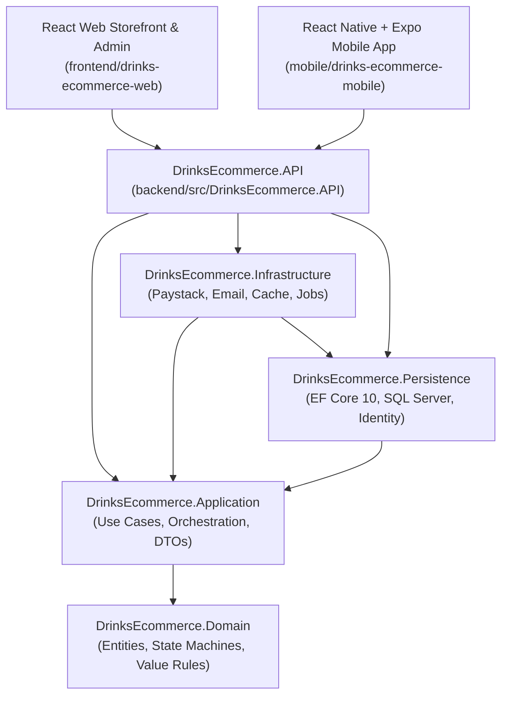

# DrinksEcommerce — Architecture

## 1. Architectural Style: Modular Monolith with Clean Architecture

`DrinksEcommerce` is structured as a single-store modular monolith targeting **.NET 10 LTS** and **C# 14**, paired with a **React + TypeScript + Vite** web application and a **React Native + TypeScript + Expo** mobile application.

## 2. Layer Responsibilities & Dependency Rules

1. **`DrinksEcommerce.Domain`**:
   - Contains business entities (`Product`, `ProductVariant`, `InventoryItem`, `StockReservation`, `Cart`, `Order`, `Payment`, `Refund`, `ReconciliationRecord`, `DeliveryZone`, `OrderDelivery`, `Coupon`), explicit state machines (`OrderStatus`, `PaymentStatus`, `DeliveryStatus`, `RefundStatus`), and `NigerianValueRules` (exact NGN-to-kobo integer conversion and Nigerian phone number normalization).
   - Zero dependencies on outer layers (verified by `DrinksEcommerce.ArchitectureTests`).
2. **`DrinksEcommerce.Application`**:
   - Coordinates business workflows (`CatalogService`, `CartAndCheckoutService`, `PaymentOrchestratorService`, `OrderAndAdminService`), defines interfaces (`IApplicationDbContext`, `IPaymentGateway`, `INotificationService`, `ICatalogCacheService`, `IAuditService`), and exposes versioned API DTOs.
3. **`DrinksEcommerce.Persistence`**:
   - Implements `ApplicationDbContext` (`IdentityDbContext<ApplicationUser, ApplicationRole, Guid>`), Fluent API entity configurations, concurrency tokens (`RowVersion`), restrictive delete behaviors on financial records, migrations, and development seed data.
4. **`DrinksEcommerce.Infrastructure`**:
   - Implements `PaystackPaymentGateway` (typed `HttpClient`, HMAC-SHA512 constant-time signature validation, and deterministic test simulator), `NotificationService` (durable DB notifications + safe development email sink / SMTP), `CatalogCacheService` (`IMemoryCache` + optional Redis `IDistributedCache`), and `OperationsBackgroundWorker`.
5. **`DrinksEcommerce.API`**:
   - Exposes `/api/v1/*` endpoints, JWT Bearer authentication, role-based authorization policies (`AdminOnly`, `WarehouseOrAdmin`, `DeliveryOrAdmin`), rate limiting, `X-Correlation-Id` propagation, and RFC 7807 `ProblemDetails` error handling.

## 3. Core Transaction & Concurrency Boundaries

- **Checkout & Inventory Reservation**: Local order snapshot creation, payment initialization record, and stock reservation execute atomically in SQL Server before any external HTTP call to Paystack is made. SQL Server transactions are never held open across external network calls.
- **Idempotent Checkout & Payment Verification**: `POST /api/v1/checkout` enforces uniqueness on `(UserId, IdempotencyKey)`. Payment verification (`GET /api/v1/payments/{reference}/verify` and `POST /api/v1/payments/paystack/webhook`) transitions `StockReservation` from `Active` to `Committed` atomically so concurrent browser callbacks and webhooks never double-decrement inventory.
